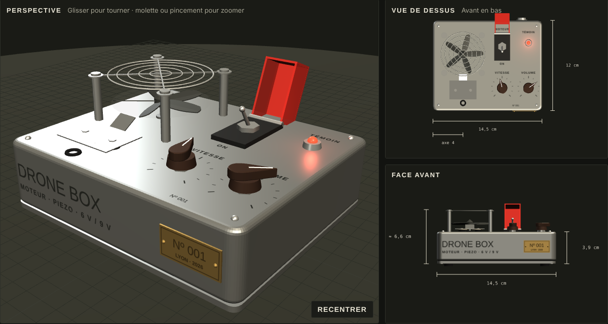
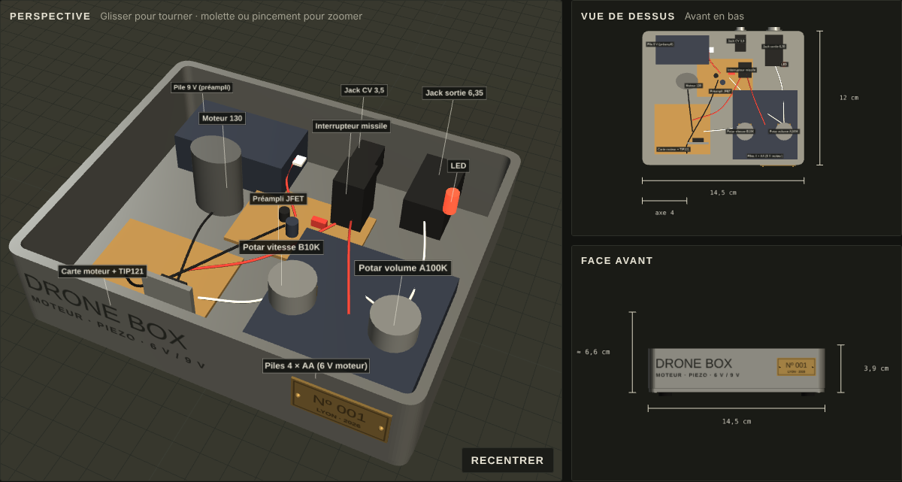
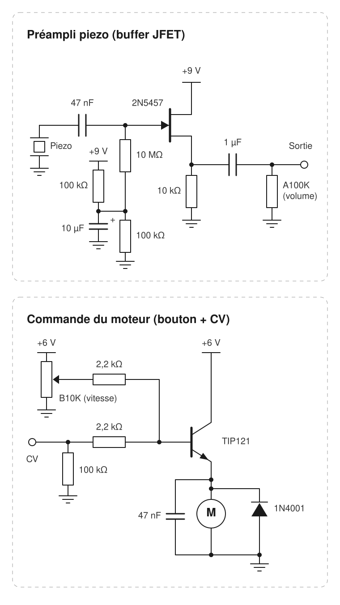

# Motor Drone

Instrument électromécanique DIY : un petit moteur DC fait tourner une hélice sous une grille, sur le dessus du boîtier. L'hélice frotte ou frappe une fine plaque d'alu, un piezo capte la vibration, et un préampli JFET l'envoie vers un jack 6,35 mm (pédalier guitare ou carte son). Résultat : des bourdonnements, grondements et pulsations qui évoluent avec la vitesse du moteur.

Inspiration : le *Rotary Drone* de The Sound of Machines.

## Ce que fait chaque boîte

- Vitesse du moteur réglable au bouton, ou pilotée par une entrée CV en 3,5 mm
- Interrupteur « missile » pour couper le moteur, LED rouge témoin
- Volume sur le piezo
- Sortie jack 6,35 mm ; débrancher le câble coupe la pile du préampli
- Boîtier alu 1590XX, boutons chicken head, look dark/indus (rivets)

## Contenu du dépôt

| Fichier | Contenu |
|---|---|
| [`docs/maquette-3d.html`](docs/maquette-3d.html) | Maquette 3D interactive : trois vues cotées, vue rayons X, plan de perçage |
| [`docs/schema.svg`](docs/schema.svg) | Schéma du préampli piezo et de la commande moteur |
| [`docs/circuit.md`](docs/circuit.md) | Explication du circuit, câblage et notes de montage |
| [`docs/achats.md`](docs/achats.md) | Liste d'achats détaillée avec liens et prix |
| [`bom/sourcing.csv`](bom/sourcing.csv) | La même liste en CSV (séparateur `;`) |
| [`bom/boitiers.csv`](bom/boitiers.csv) | Comparatif des boîtiers UE / Chine / US |

## Maquette 3D

### Vue intérieure

Dessus retiré : moteur 130 monté debout, potentiomètres, interrupteur missile, LED et jacks fixés au boîtier ; piles 4 × AA (moteur) et 9 V (préampli), carte de commande moteur avec le TIP121 et carte du préampli JFET. Placement des piles et des cartes indicatif.

Pour la manipuler, télécharge [`docs/maquette-3d.html`](docs/maquette-3d.html) et ouvre-le dans un navigateur (connexion internet nécessaire pour charger three.js). On peut faire tourner le boîtier, actionner l'interrupteur missile, régler vitesse et volume, passer en noir mat, voir l'intérieur en rayons X ou retirer le dessus (vue « Intérieur », pièces légendées). Le plan de perçage est en bas de la page et dans [`docs/circuit.md`](docs/circuit.md).

## Schéma

## Budget (2 boîtes, relevé le 12/11/2026)

| Commande | Ce qu'on y prend | Total port compris |
|---|---|---:|
| Musikding (DE) | boîtiers, boutons, toute l'électronique | 57,30 € |
| Berrybase (DE) | moteurs, interrupteurs missile, clips de piles | 21,80 € |
| Gotronic (FR) | hélices, piezos, grilles, supports de LED, passe-câbles | 24,30 € |
| Castorama | tôle alu 0,5 mm pour la plaque vibrante | 9,49 € |
| **Total** | | **112,89 €** |

Environ **56 € par boîte**. À ajouter si besoin : foret étagé 4-20 mm (14,50 €). Options (alim 9 V, pieds, kit de rivets, moteur plus silencieux) : environ 32 €.

## Pourquoi pas AliExpress

Depuis le 1er juillet 2026, chaque colis hors UE paie 3 € de droit de douane **par catégorie de produit**, et 2 € de frais de traitement en plus depuis le 1er novembre 2026 ([douane.gouv.fr](https://www.douane.gouv.fr/petits-colis-ce-qui-change-pour-vos-achats-en-ligne)). Ce projet compte beaucoup de petites pièces différentes : le même panier sur AliExpress reviendrait entre 170 et 260 €.

Même pour le boîtier seul, l'UE gagne : 22 € les deux chez Musikding, contre environ 40 € sur AliExpress France (prix vérifiés le 12/11/2026), et la livraison est plus rapide. Mouser a le Hammond 1590XX d'origine, mais à 18,95 € HT pièce. Détail dans [`bom/boitiers.csv`](bom/boitiers.csv).
