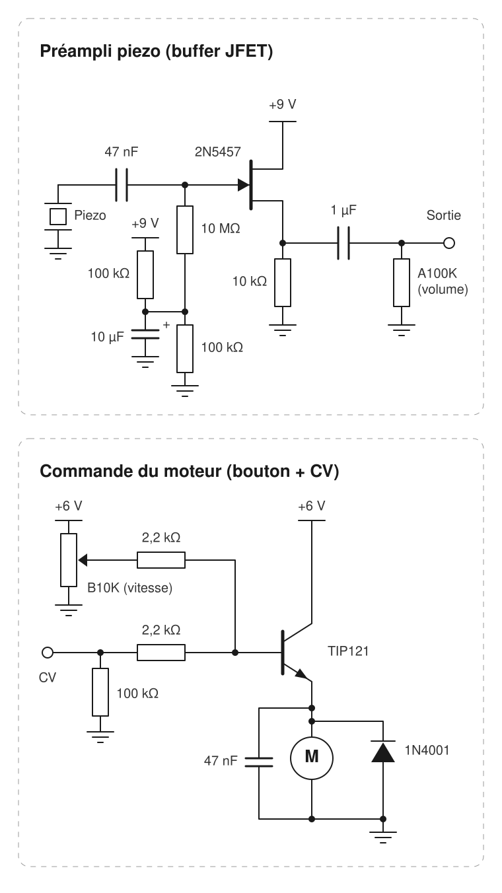

# Circuit et montage

## Préampli piezo (buffer JFET, 9 V)

Le piezo a une impédance très élevée : branché directement sur une entrée guitare, il sonne maigre et aigu. Un JFET monté en suiveur de source lui présente une charge de plusieurs mégohms et sort en basse impédance.

- **Polarisation :** pont 100 kΩ / 100 kΩ sur le 9 V, découplé par un 10 µF, ce qui donne 4,5 V. La grille y est reliée par une 10 MΩ.
- **Entrée :** condensateur MKT 47 nF entre le piezo et la grille.
- **Source :** 10 kΩ vers la masse ; c'est là que sort le signal.
- **Sortie :** MKT 1 µF, puis potentiomètre A100K de volume : cosse 3 côté condensateur, cosse 1 à la masse, curseur vers la pointe du jack.
- **Alimentation :** pile 9 V. Le moins de la pile passe par l'anneau du jack stéréo, relié à la masse quand on branche un câble mono : débrancher coupe le préampli.
- **2N5457 de Musikding :** c'est un MMBF5457 CMS soudé sur un adaptateur. Un client indique l'ordre source, drain, grille ; vérifier avant de souder. Une fois monté, on doit lire environ 5 à 6 V sur la source.

## Commande du moteur (6 V, 4 piles AA)

Le TIP121 est monté en suiveur d'émetteur : la tension du moteur suit celle de la base, moins environ 1,2 V.

- **Bouton de vitesse :** potentiomètre B10K entre le 6 V et la masse, curseur vers la base par une 2,2 kΩ.
- **Entrée CV :** jack 3,5 mm mono, 100 kΩ vers la masse, puis 2,2 kΩ vers la base. Le CV s'ajoute à la position du bouton.
- **Moteur :** entre l'émetteur et la masse, avec une diode 1N4001 en roue libre (bague côté +) et un MKT 47 nF en parallèle contre les parasites.
- **Interrupteur missile :** en série sur le + des piles.
- **LED :** sur le 6 V après l'interrupteur, avec une 1 kΩ.
- **TIP121 :** brochage base, collecteur, émetteur. Le visser sur son dissipateur.

## Mécanique

- **Moteur :** l'Adafruit 711 (taille 130) mesure 27,5 mm de long et tient debout dans le boîtier de 39 mm, l'axe traversant le dessus. Le monter sur passe-câbles en caoutchouc pour limiter la transmission des vibrations au boîtier.
- **Hélice :** au-dessus du boîtier, sous la grille, posée sur 4 entretoises M3 × 25 mm. Les hélices de 58 mm dépassent un peu la grille de 60 mm : rogner les pales de 2 à 3 mm, ou prendre une grille de 80 mm.
- **Plaque vibrante :** découpée dans la tôle alu de 0,5 mm, montée souple, au contact de l'hélice. Le piezo est collé dessous (cyanoacrylate ou époxy) et relié au préampli en fil blindé.
- **Piezo :** centre du disque vers la pointe du jack, bord laiton à la masse.
- **Circuits :** une plaque à bandes 50 × 100 mm par boîte, coupée en deux (préampli et commande moteur).

## Plan de perçage

Positions en mm depuis le bord gauche et le bord avant du dessus, boîtier Box Type JJ (145 × 120 × 39 mm) posé sur son couvercle. Même plan dans la [maquette 3D](maquette-3d.html). Mesurer le boîtier et les pièces avant de tracer.

| Élément | Face | Position (mm) | Perçage |
|---|---|---|---|
| Axe moteur + hélice Ø 58 | Dessus | 40 · 75 | Ø 7 pour le palier + 2 vis du moteur, à reporter sur la pièce |
| Grille 60 × 60 sur entretoises M3 × 25 | Dessus | (15 · 50) (65 · 50) (15 · 100) (65 · 100) | 4 × Ø 3,2 |
| Plaque vibrante sur passe-câbles | Dessus | (30 · 27) et (50 · 27) | 2 × Ø 8 (PC3) |
| Passage des fils des piezos | Dessus | 40 · 10 | Ø 8 + passe-câble |
| Bouton vitesse (B10K) | Dessus | 92 · 30 | Ø 7 |
| Bouton volume (A100K) | Dessus | 127 · 30 | Ø 7 |
| Interrupteur missile | Dessus | 92 · 85 | Ø 12 (à mesurer) |
| LED + support chromé | Dessus | 127 · 90 | Ø 8,5 |
| Jack 6,35 sortie | Arrière | 118 du bord gauche (vu de face) · 19 du bas | Ø 9 |
| Jack 3,5 entrée CV | Arrière | 88 du bord gauche (vu de face) · 19 du bas | Ø 6 |

Hauteur hors tout avec la grille : environ 6,6 cm.

## Option alimentation 9 V

Pour se passer des piles : jack DC 2,1 mm isolé, régulateur 7806 pour le 6 V du moteur, et filtre 100 Ω + 100 µF pour le préampli. La polarité du jack DC n'est pas indiquée par le vendeur : vérifier au câblage (standard pédale : centre négatif).
